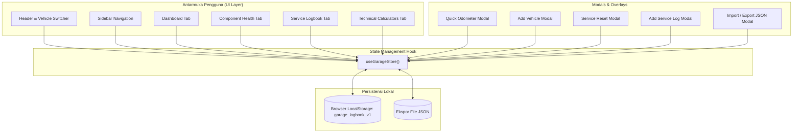
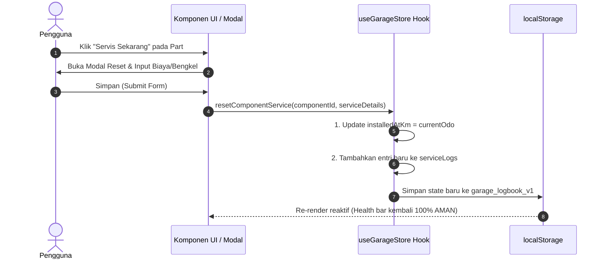

# 📘 DOKUMENTASI SISTEM: VELO & MOTO GARAGE LOGBOOK

Aplikasi manajemen pemeliharaan multi-kendaraan (**Mobil, Motor, dan Sepeda**) berarsitektur **Local-First Web Application** dengan antarmuka bertema **Tactical Garage Dark Theme**.

---

## 📑 DAFTAR ISI
1. [Ringkasan Eksekutif & Konsep Dasar](#1-ringkasan-eksekutif--konsep-dasar)
2. [Arsitektur Sistem & Diagram](#2-arsitektur-sistem--diagram)
3. [Teknologi & Dependensi (Tech Stack)](#3-teknologi--dependensi-tech-stack)
4. [Struktur Folder & Penjelasan File](#4-struktur-folder--penjelasan-file)
5. [Skema Data & Entitas Penyimpanan](#5-skema-data--entitas-penyimpanan)
6. [Panduan Fitur & Modul Fungsional](#6-panduan-fitur--modul-fungsional)
   - [A. Manajemen Armada (Multi-Vehicle Fleet)](#a-manajemen-armada-multi-vehicle-fleet)
   - [B. Telemetri & Pemantauan Kesehatan Part](#b-telemetri--pemantauan-kesehatan-part)
   - [C. Logbook Servis & Analisis Biaya (Rp / km)](#c-logbook-servis--analisis-biaya-rp--km)
   - [D. Kalkulator Teknis & Utilitas Adaptif](#d-kalkulator-teknis--utilitas-adaptif)
   - [E. Cadangan Data & Pemulihan (Local-First Backup)](#e-cadangan-data--pemulihan-local-first-backup)
7. [Formulasi Matematika & Algoritma](#7-formulasi-matematika--algoritma)
8. [Preset Suku Cadang Standar Pabrikan](#8-preset-suku-cadang-standar-pabrikan)
9. [Panduan Instalasi, Menjalankan, & Build](#9-panduan-instalasi-menjalankan--build)
10. [FAQ & Pemecahan Masalah](#10-faq--pemecahan-masalah)

---

## 1. Ringkasan Eksekutif & Konsep Dasar

**Velo & Moto Garage Logbook** dirancang untuk pemilik multi-kendaraan yang membutuhkan sistem pencatatan pemeliharaan terstruktur, pemantauan masa pakai suku cadang (*wearable parts*), serta alat bantu kalkulasi teknis otomotif dan sepeda balap tanpa ketergantungan pada backend server pihak ketiga (*zero external backend*).

### 🌟 Nilai Utama Sistem
- **Local-First & Privasi Mutlak:** Seluruh data (riwayat servis, pelat nomor, pengeluaran, rute) tersimpan 100% di browser pengguna melalui `localStorage`. Tidak ada data yang dikirim atau bocor ke server pihak ketiga.
- **Prediksi Keausan Berbasis Odometer:** Setiap suku cadang memiliki *baseline* pemasangan dan target interval penggantian dalam kilometer.
- **Analisis Biaya Riil ($\text{Rp} / \text{km}$):** Menghitung rasio pengeluaran per kilometer yang ditempuh secara transparan.
- **Estetika Tactical Garage:** Desain gelap beresolusi kontras tinggi (Slate-950/900, Zinc-800, aksen Emerald/Amber/Rose) dengan tipografi monospace JetBrains Mono untuk angka telemetri.

---

## 2. Arsitektur Sistem & Diagram

Aplikasi mengadopsi pola **Single Page Application (SPA)** reaktif dengan state terpusat melalui Custom Hook yang secara otomatis menyinkronkan perubahan ke browser storage.

### A. Diagram Arsitektur Komponen



### B. Diagram Alur Data Servis & Reset Part



---

## 3. Teknologi & Dependensi (Tech Stack)

| Kategori | Modul / Library | Versi | Peran dalam Sistem |
|---|---|---|---|
| **Core Framework** | React | `^18.3.1` | Komponen fungsional & hook siklus hidup |
| **DOM Engine** | React-DOM | `^18.3.1` | Rendering DOM pada browser |
| **Bundler & Build** | Vite | `^6.0.5` | Dev-server kilat berbasis ES Modules & compiler bundel |
| **Styling** | Tailwind CSS | `^3.4.17` | Utility-first styling dengan palet warna dark taktikal |
| **CSS Post-processor** | PostCSS & Autoprefixer | `^8.4.49` | Kompatibilitas browser modern |
| **Icon Pack** | Lucide React | `^0.468.0` | Ikon visual SVG minimalis & adaptif |
| **Tipografi** | Inter & JetBrains Mono | Google Fonts | Inter untuk antarmuka teks, JetBrains Mono untuk angka telemetri |

---

## 4. Struktur Folder & Penjelasan File

```plaintext
d:\garage-logbook\
├── docs\
│   ├── ARCHITECTURE.md                 # Dokumen blueprint arsitektur v1.0
│   └── DOKUMENTASI_LENGKAP.md          # Dokumentasi teknis versi markdown docs
├── src\
│   ├── components\
│   │   ├── components-health\
│   │   │   ├── AddComponentModal.jsx   # Modal tambah suku cadang baru secara manual
│   │   │   ├── ComponentCard.jsx       # Kartu visual wear bar indikator warna & tombol aksi
│   │   │   ├── ComponentHealthView.jsx # Tampilan tab kesehatan part (Grid & Tabel, Filter)
│   │   │   └── ServiceResetModal.jsx   # Modal one-click reset & catat pengeluaran servis
│   │   ├── dashboard\
│   │   │   └── Dashboard.jsx           # Beranda telemetry Odo, ringkasan part kritis, & biaya
│   │   ├── layout\
│   │   │   ├── AddVehicleModal.jsx     # Formulir pendaftaran unit kendaraan baru
│   │   │   ├── Header.jsx              # Navbar atas, selector kendaraan, & tombol Quick Odo
│   │   │   ├── ImportModal.jsx         # Modal upload atau tempel JSON backup data
│   │   │   ├── QuickOdoModal.jsx       # Modal update cepat kilometer kendaraan
│   │   │   ├── Sidebar.jsx             # Navigasi samping dengan counter badge status kritis
│   │   │   └── VehicleSelector.jsx     # Menu drop-down pergantian unit aktif
│   │   ├── logbook\
│   │   │   ├── AddServiceLogModal.jsx  # Modal catat servis baru + multi-reset suku cadang
│   │   │   ├── CostAnalyticsCards.jsx  # Kartu metrik total biaya & biaya per km (Rp/km)
│   │   │   └── ServiceLogbookView.jsx  # Riwayat log servis, pencarian, filter, & sortir
│   │   └── tools\
│   │       ├── BikeCalculators.jsx     # Kalkulator tekanan ban Frank Berto & gear ratio
│   │       ├── FuelCalculator.jsx      # Kalkulator konsumsi BBM (km/L) & estimasi biaya trip
│   │       ├── TaxReminderCard.jsx     # Peringatan jatuh tempo Pajak STNK 1 Thn & Plat 5 Thn
│   │       └── ToolsView.jsx           # Kontainer kalkulator adaptif sesuai tipe kendaraan
│   ├── data\
│   │   └── presets.js                  # Starter fleet, preset suku cadang pabrikan, & paket servis
│   ├── hooks\
│   │   └── useGarageStore.js           # Custom hook manajemen state utama & LocalStorage sync
│   ├── utils\
│   │   └── calculators.js              # Kumpulan fungsi murni kalkulasi (health, BBM, tekanan ban)
│   ├── App.jsx                         # Shell aplikasi utama & router navigasi tab
│   ├── index.css                       # Definisi Tailwind directives & styling global
│   └── main.jsx                        # Entry point eksekusi React ke DOM
├── DOCUMENTATION.md                    # Dokumentasi komprehensif sistem (file ini)
├── index.html                          # Template berkas HTML root
├── package.json                        # Konfigurasi dependensi dan skrip proyek
├── tailwind.config.js                  # Konfigurasi tema warna dan font Tailwind
└── vite.config.js                      # Konfigurasi bundler Vite
```

---

## 5. Skema Data & Entitas Penyimpanan

Semua state garasi disatukan di bawah satu kunci penyimpanan `localStorage`: `garage_logbook_v1`.

### A. Struktur Root JSON
```json
{
  "version": "1.2.0",
  "exportedAt": "2026-10-20T09:00:00.000Z",
  "activeVehicleId": "veh_civic_001",
  "vehicles": [],
  "components": [],
  "serviceLogs": [],
  "fuelLogs": []
}
```

### B. Entitas Kendaraan (`Vehicle`)
Mendukung 3 kategori: `CAR`, `MOTORCYCLE`, dan `BICYCLE`.

```typescript
interface Vehicle {
  id: string;               // ID unik (contoh: "veh_1729384910_a8f2")
  name: string;             // Nama panggilan (contoh: "Civic RS Turbo")
  category: 'CAR' | 'MOTORCYCLE' | 'BICYCLE';
  brand: string;            // Pabrikan (contoh: "Honda", "Yamaha", "Polygon")
  model: string;            // Model unit
  year: number;             // Tahun perakitan (contoh: 2022)
  currentOdo: number;       // Odometer berjalan saat ini (km)
  initialOdo: number;       // Odometer baseline saat pertama masuk garasi
  createdAt: string;        // Timestamp ISO 8601
  updatedAt: string;        // Timestamp ISO 8601
  notes?: string;           // Catatan spesifikasi teknis

  // Khusus Mobil & Motor (Motorized):
  plateNumber?: string;      // Plat Nomor (contoh: "B 1234 GTR")
  stnkExpiryDate?: string;   // Tanggal Pajak Tahunan STNK (YYYY-MM-DD)
  plateExpiryDate?: string;  // Tanggal Ganti Plat 5 Tahunan (YYYY-MM-DD)
  fuelType?: string;        // Jenis BBM (contoh: "RON 92 (Pertamax)")
  tankCapacityLiters?: number; // Kapasitas tangki (Liter)

  // Khusus Sepeda (Bicycle):
  frameset?: string;        // Spesifikasi frame (contoh: "ACX Carbon Disc")
  groupset?: string;        // Shifter & Drivetrain (contoh: "Shimano Ultegra 2x11s")
  wheelset?: string;        // Profil velg (contoh: "Entity Carbon 45mm")
  tireWidthMm?: number;     // Lebar nominal ban dalam mm (contoh: 28)
  riderWeightKg?: number;   // Bobot pengendara (kg)
  bikeWeightKg?: number;    // Bobot sepeda (kg)
  isTubeless?: boolean;     // Apakah menggunakan setup ban tubeless
}
```

### C. Entitas Suku Cadang (`ComponentHealth`)
```typescript
interface ComponentHealth {
  id: string;               // ID unik komponen
  vehicleId: string;        // Foreign key mengacu ke Vehicle.id
  name: string;             // Nama komponen (contoh: "Oli Mesin", "V-Belt")
  category: string;         // Kategori (Pelumasan, Transmisi, Pengereman, dll.)
  installedAtKm: number;    // Odometer kendaraan saat part dipasang / diservis
  lifespanKm: number;       // Batas rekomendasi masa pakai (km)
  lastServicedDate: string; // Tanggal servis terakhir (YYYY-MM-DD)
  notes?: string;           // Keterangan spesifikasi sparepart
  key?: string;             // Kunci referensi preset standar
}
```

### D. Entitas Logbook Servis (`ServiceLog`)
```typescript
interface ServiceLog {
  id: string;               // ID unik catatan
  vehicleId: string;        // Foreign key mengacu ke Vehicle.id
  date: string;             // Tanggal pengerjaan (YYYY-MM-DD)
  odometer: number;         // Angka odometer saat servis dilakukan (km)
  category: 
    | 'ROUTINE_SERVICE'     // Servis Berkala
    | 'PART_REPLACEMENT'    // Penggantian Sparepart
    | 'MODIFICATION'        // Modifikasi / Aksesoris
    | 'TAX_DOCUMENT'        // Pajak STNK / Administrasi
    | 'INSPECTION';         // Pengecekan / Diagnosa
  title: string;            // Ringkasan judul servis
  costRp: number;           // Total biaya dalam Rupiah
  workshop: string;         // Nama bengkel pengerjaan atau "DIY / Sendiri"
  notes: string;            // Rincian nota atau catatan mekanik
  replacedComponentIds?: string[]; // Daftar ID part yang di-reset oleh servis ini
}
```

### E. Entitas Log Pengisian BBM (`FuelLog`)
```typescript
interface FuelLog {
  id: string;               // ID unik transaksi
  vehicleId: string;        // Foreign key mengacu ke Vehicle.id
  date: string;             // Tanggal pengisian (YYYY-MM-DD)
  odometer: number;         // Odometer saat isi bensin (km)
  liters: number;           // Jumlah liter yang diisi
  totalCostRp: number;      // Total pengeluaran (Rp)
  pricePerLiterRp: number;  // Harga per liter (Rp/L)
  isFullTank: boolean;      // Apakah diisi penuh (mendukung hitungan Full-to-Full)
  notes?: string;           // Nama SPBU atau catatan tambahan
}
```

---

## 6. Panduan Fitur & Modul Fungsional

### A. Manajemen Armada (Multi-Vehicle Fleet)
1. **Pilihan Unit Seketika:** Ganti kendaraan aktif secara instan melalui dropdown pada header atas.
2. **Pendaftaran Kendaraan Baru:** Tombol `+ Tambah Unit` membuka modal dengan opsi kategori (*Mobil*, *Motor*, atau *Sepeda*). Form otomatis menyesuaikan input sesuai kategori terpilih.
3. **Pembaruan Odometer Kilat (Quick Odo):** Tombol speedometer di header memungkinkan pengemudi memasukkan angka odometer terbaru dalam hitungan detik tanpa membuka menu edit.
4. **Armada Default (Starter Fleet):**
   - 🚗 **Mobil:** Honda Civic RS Turbo (28.450 km)
   - 🏍️ **Motor:** Yamaha NMAX 155 Connected / ABS (14.800 km)
   - 🚲 **Sepeda:** Polygon Strattos S8 Disc Carbon (2.150 km)

---

### B. Telemetri & Pemantauan Kesehatan Part
Tab **Kesehatan Part** (`ComponentHealthView.jsx`) menyajikan status seluruh komponen yang dapat aus (*wearable parts*).

1. **Visual Wear Bar & Indikator Warna:**
   - 🟢 **AMAN (Emerald):** Sisa umur $> 25\%$ dan sisa kilometer $> 0\text{ km}$.
   - 🟡 **WAKTUNYA SERVIS (Amber):** Sisa umur $\le 25\%$ dan sisa kilometer $> 0\text{ km}$.
   - 🔴 **OVERDUE (Rose):** Sisa kilometer $\le 0\text{ km}$ (melewati batas rekomendasi pabrikan).
2. **One-Click "Servis Sekarang & Reset":**
   - Membuka modal konfirmasi dengan estimasi kilometer servis saat ini.
   - Mengisi biaya, tanggal, dan nama bengkel.
   - Otomatis mereset angka `installedAtKm` suku cadang dan membuat entri baru di Logbook Servis.
3. **Paket Servis Motor (Smart Bundles):**
   - Fasilitas reset serentak untuk perawatan berkala:
     - *Paket Ganti Oli Rutin:* Oli Mesin + Oli Gardan.
     - *Paket Tune Up & Injeksi:* Oli Mesin + Busi + Filter Udara + Servis Throttle Body.
     - *Paket Servis CVT:* Servis CVT + Roller + V-Belt + Oli Gardan.
     - *Paket Pengereman:* Kampas Rem Depan + Belakang + Minyak Rem.
4. **Mode Tampilan:** Dapat dialihkan antara tampilan **Kartu Grid** atau **Tabel Kompak**.

---

### C. Logbook Servis & Analisis Biaya ($\text{Rp} / \text{km}$)
Tab **Riwayat Servis** (`ServiceLogbookView.jsx`) mencatat seluruh riwayat pengerjaan perawatan dan kalkulasi biaya operasional.

1. **Analisis Finansial Cerdas:**
   - **Total Biaya Servis:** Akumulasi seluruh pengeluaran perawatan.
   - **Rata-Rata per Servis:** Biaya rata-rata setiap kunjungan bengkel.
   - **Biaya per Kilometer ($\text{Rp} / \text{km}$):** Menghitung nilai riil pengeluaran per kilometer yang telah ditempuh kendaraan.
2. **Pencatatan Multi-Part:** Saat menambahkan servis baru, pengguna dapat mencentang beberapa suku cadang sekaligus agar status masa pakainya ter-reset bersamaan.
3. **Pencarian & Penyaringan:**
   - Pencarian berdasarkan judul, catatan, atau nama bengkel.
   - Filter kategori: Servis Rutin, Ganti Part, Modifikasi, Pajak STNK, Inspeksi.
   - Sortir berdasarkan: Tanggal terbaru, Odometer tertinggi, Biaya terbesar.

---

### D. Kalkulator Teknis & Utilitas Adaptif
Tab **Kalkulator Teknis** (`ToolsView.jsx`) otomatis menampilkan utilitas yang relevan dengan jenis kendaraan aktif:

#### 1. Utilitas Mobil & Motor
- **Kalkulator BBM Full-to-Full:**
  - Menghitung efisiensi bahan bakar rata-rata ($\text{km/L}$) berdasarkan delta kilometer antar pengisian tangki penuh.
  - Menyimpan riwayat log BBM lengkap dengan rincian biaya dan volume liter.
- **Estimator Biaya Perjalanan (Trip Cost):**
  - Masukkan estimasi jarak (km), konsumsi BBM rata-rata (km/L), dan harga bensin per liter (Rp).
  - Menghitung kebutuhan liter bensin dan total estimasi rupiah yang dibutuhkan.
- **Pengingat Pajak STNK & Plat Nomor:**
  - Countdown sisa hari hingga tanggal jatuh tempo Pajak Tahunan STNK (1 tahun) dan Ganti Plat (5 tahun).
  - Status warna: Hijau (Aman), Kuning ($\le 45$ hari), Merah ($\le 14$ hari atau terlewat).
  - Tombol aksi cepat untuk memperpanjang tanggal dan mencatat biaya pajak ke logbook.

#### 2. Utilitas Sepeda Balap / Gravel
- **Frank Berto Smart Tire Pressure Calculator:**
  - Menghitung tekanan ban ideal Depan dan Belakang (dalam satuan `PSI` dan `Bar`).
  - Parameter: Bobot Rider (kg), Bobot Sepeda (kg), Lebar Ban (25c – 45c), Tipe Jalan (Aspal Mulus, Aspal Kasar/Basah, Gravel), dan Tipe Casing (Ban Dalam vs Tubeless).
- **Gear Ratio & Cadence Speed Calculator:**
  - Menghitung rasio gir ($T_{\text{depan}} / T_{\text{belakang}}$) dan jarak tempuh per kayuhan (*development meters*).
  - Menghitung estimasi kecepatan ($\text{km/jam}$) pada target cadence (RPM).
  - Menyajikan matriks kecepatan lengkap untuk seluruh kombinasi 11-speed cassette.

---

### E. Cadangan Data & Pemulihan (Local-First Backup)
1. **Ekspor Cadangan:** Menghasilkan berkas cadangan JSON bersih berstempel waktu (`velo-moto-garage-backup-[tanggal].json`).
2. **Impor Cadangan:** Memungkinkan pengguna mengunggah file `.json` atau menempelkan teks JSON secara langsung. Sistem memvalidasi struktur data sebelum mengganti state aktif.
3. **Reset ke Data Percontohan:** Mengembalikan armada percontohan bawaan jika pengguna ingin memulai dari awal.

---

## 7. Formulasi Matematika & Algoritma

### 1. Perhitungan Sisa Masa Pakai Suku Cadang
Diberikan odometer saat ini $O_{\text{current}}$, odometer pemasangan $O_{\text{installed}}$, dan target masa pakai $L$:

$$\text{Km Terpakai} = \max(0, O_{\text{current}} - O_{\text{installed}})$$

$$\text{Sisa Km} = L - \text{Km Terpakai}$$

$$\text{Sisa Persentase} = \max\left(0, \min\left(100, \left( \frac{\text{Sisa Km}}{L} \right) \times 100 \right)\right)$$

### 2. Analisis Biaya per Kilometer ($\text{Rp} / \text{km}$)
Diberikan total pengeluaran perawatan $C_{\text{total}}$, odometer saat ini $O_{\text{current}}$, dan odometer awal unit $O_{\text{initial}}$:

$$\Delta D = \max(1, O_{\text{current}} - O_{\text{initial}})$$

$$\text{Biaya per Km} = \text{round}\left(\frac{C_{\text{total}}}{\Delta D}\right)$$

### 3. Konsumsi BBM Metode Full-to-Full
$$\text{Efisiensi (km/L)} = \frac{O_{\text{terkini}} - O_{\text{sebelumnya}}}{\text{Liter Diisi}}$$

### 4. Tekanan Ban Sepeda (Frank Berto Approximation)
Distribusi bobot sepeda normal dimodelkan $42\%$ roda depan dan $58\%$ roda belakang:

$$\text{Bobot Total (kg)} = W_{\text{rider}} + W_{\text{bike}}$$

$$\text{Rear PSI (Base)} = \left(\frac{\text{Bobot Total}}{W_{\text{tire}} \times 0.038}\right) \times 0.58 \times 0.95$$

$$\text{Front PSI} = \text{Rear PSI} \times \left(\frac{0.42}{0.58}\right)$$

*Koreksi Permukaan & Setup:*
- Aspal Kering: $\times 1.00$
- Aspal Basah / Kasar: $\times 0.92$
- Gravel: $\times 0.82$
- Ban Tubeless: $\times 0.91$ (pengurangan $9\%$ karena resistensi pinch-flat yang lebih rendah)

### 5. Gear Ratio & Kecepatan Sepeda
Diberikan jumlah gigi chainring depan $T_f$, jumlah gigi cog belakang $T_r$, lingkar ban $C_m$ (meter), dan cadence $R$ (RPM):

$$\text{Gear Ratio} = \frac{T_f}{T_r}$$

$$\text{Development (m)} = \text{Gear Ratio} \times C_m$$

$$\text{Kecepatan (km/h)} = \frac{\text{Development (m)} \times R \times 60}{1000}$$

---

## 8. Preset Suku Cadang Standar Pabrikan

### Mobil (CAR)
| Komponen | Interval Target | Kategori | Keterangan |
|---|---|---|---|
| Oli Mesin & Filter Oli | 10.000 km | Pelumasan | Oli full-sintetik & ganti filter oli |
| Oli Transmisi (ATF/CVT) | 40.000 km | Transmisi | Kuras oli transmisi matic / manual |
| Kampas Rem (Brake Pads) | 30.000 km | Pengereman | Inspeksi ketebalan kampas depan/belakang |
| Filter Udara Mesin | 20.000 km | Intake | Penggantian filter udara intake ruang bakar |
| Rotasi Ban & Spooring | 10.000 km | Roda & Suspensi | Rotasi ban menyilang agar tapak aus merata |

### Motor (MOTORCYCLE - 14 Komponen Granular Standar + Ban)
| Komponen | Interval Target | Jenis Motor | Keterangan |
|---|---|---|---|
| Oli Mesin | 3.000 km | Semua Motor | Oli mesin 4-tak / matic |
| Oli Gardan / Gear Oil | 9.000 km | Khusus Matic | Pelumas rasio roda belakang |
| Filter Oli Mesin | 9.000 km | Semua Motor | Saringan oli karter / elemen filter |
| Servis Throttle Body & Injektor | 8.000 km | Semua Motor | Bersihkan TB, injector cleaner, kalibrasi TPS |
| Busi (Spark Plug) | 9.000 km | Semua Motor | Busi pengapian standar / iridium |
| Filter Udara (Air Filter) | 12.000 km | Semua Motor | Saringan udara intake viscous |
| Kampas Rem Depan | 12.000 km | Semua Motor | Kampas rem cakram depan |
| Kampas Rem Belakang | 12.000 km | Semua Motor | Kampas rem cakram / tromol belakang |
| Servis CVT (Clean & Grease) | 8.000 km | Khusus Matic | Pembersihan debu mangkok kopling & gemuk CVT |
| Roller CVT | 16.000 km | Khusus Matic | Roller pemberat pulley primer |
| V-Belt Drive | 20.000 km | Khusus Matic | Sabuk penggerak CVT |
| Rantai & Gir Set | 20.000 km | Khusus Bebek/Sport | Sprocket depan-belakang & rantai roda |
| Air Radiator / Coolant | 14.000 km | Liquid Cooled | Kuras & isi air radiator baru |
| Minyak Rem (Brake Fluid) | 20.000 km | Semua Motor | Kuras minyak rem DOT 3 / DOT 4 |
| Ban Depan Tubeless | 15.000 km | Semua Motor | Pemeriksaan TWI & alur ban depan |
| Ban Belakang Tubeless | 12.000 km | Semua Motor | Pemeriksaan TWI & alur ban belakang |

### Sepeda (BICYCLE)
| Komponen | Interval Target | Keterangan |
|---|---|---|
| Chain Lube / Wax | 250 km | Degrease & re-lube pelumas rantai atau hot wax |
| Rantai Sepeda | 3.000 km | Cek keausan rantai ($0.5\%$ wear indicator) |
| Ban Luar (Tires) | 4.000 km | Penggantian ban luar depan / belakang |
| Bar Tape / Grip | 5.000 km | Kebersihan dan kenyamanan handlebar tape |
| Brake Pads (Disc / Rim) | 3.000 km | Ketebalan kampas rem cakram hidrolik / velg |

---

## 9. Panduan Instalasi, Menjalankan, & Build

### Persyaratan Lingkungan
- **Node.js:** Versi 18.x atau lebih baru
- **NPM:** Versi 9.x atau lebih baru

### 1. Pemasangan Dependensi
Buka terminal pada direktori proyek (`d:\garage-logbook`) lalu jalankan:
```bash
npm install
```

### 2. Menjalankan Mode Development
Untuk memulai server pengembangan dengan fitur Hot Reload:
```bash
npm run dev
```
Buka peramban pada alamat lokal: `http://localhost:5173`

### 3. Membangun Bundel Produksi (Production Build)
Untuk menghasilkan berkas statis siap rilis:
```bash
npm run build
```
Hasil berkas produksi akan tersimpan di dalam folder `dist/` dan siap disematkan ke platform hosting mana pun (Vercel, Cloudflare Pages, Netlify, GitHub Pages, atau web server lokal Nginx/Apache).

### 4. Pratinjau Hasil Build Produksi
Untuk menguji hasil kompilasi produksi secara lokal:
```bash
npm run preview
```

---

## 10. FAQ & Pemecahan Masalah

#### Q: Apakah data saya hilang jika browser ditutup atau komputer dimatikan?
**Tidak.** Seluruh data otomatis tersimpan di `localStorage` peramban Anda. Namun, jika Anda membersihkan riwayat penjelajahan (*Clear Browsing Data / Storage*), data lokal dapat terhapus. Sangat disarankan untuk rutin mengekspor cadangan melalui tombol **Ekspor Cadangan (.JSON)** di menu sidebar.

#### Q: Bagaimana cara memindahkan data garasi ke laptop atau perangkat lain?
1. Pada laptop lama: Buka Sidebar > Klik **Ekspor Cadangan** > Simpan berkas `.json`.
2. Pada laptop baru: Buka aplikasi > Buka Sidebar > Klik **Impor Cadangan** > Pilih berkas `.json` tersebut. Seluruh armada dan riwayat servis akan langsung pulih.

#### Q: Bagaimana cara menambah suku cadang kustom yang belum ada di daftar preset?
Buka tab **Kesehatan Part** > Klik tombol **+ Tambah Part** di pojok kanan atas > Masukkan nama part, kategori, odometer pemasangan, dan target kilometer masa pakai.

#### Q: Apakah aplikasi dapat digunakan saat tidak ada koneksi internet (Offline)?
**Ya.** Karena aplikasi bersifat 100% *Local-First* dan seluruh pustaka serta aset font telah dibundel, aplikasi dapat dijalankan secara luring (*offline*) sepenuhnya.

---

*Velo & Moto Garage Logbook — Engineered for precision vehicle tracking & telemetry.*
