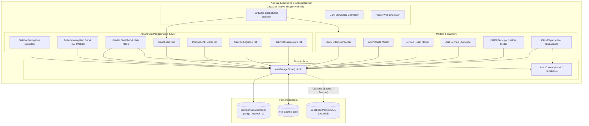
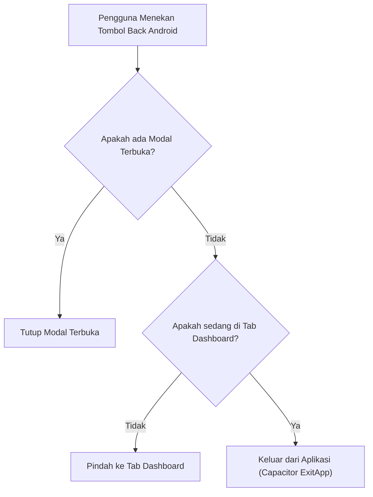

# 📖 Dokumentasi Lengkap Sistem: Velo & Moto Garage Logbook

Aplikasi manajemen pemeliharaan multi-kendaraan (**Mobil, Motor, dan Sepeda**) berarsitektur **Hybrid Local-First & Cloud-Enabled Web + Android Mobile Application** dengan antarmuka bertema **Tactical Garage Dark Theme**.

---

## 📑 DAFTAR ISI
1. [Ringkasan Eksekutif & Konsep Dasar](#1-ringkasan-eksekutif--konsep-dasar)
2. [Arsitektur Sistem & Diagram](#2-arsitektur-sistem--diagram)
3. [Teknologi & Dependensi (Tech Stack)](#3-teknologi--dependensi-tech-stack)
4. [Struktur Folder & Penjelasan Berkas](#4-struktur-folder--penjelasan-berkas)
5. [Skema Data & Entitas Penyimpanan](#5-skema-data--entitas-penyimpanan)
6. [Panduan Fitur & Modul Fungsional](#6-panduan-fitur--modul-fungsional)
   - [A. Manajemen Armada & Odometer Guard](#a-manajemen-armada--odometer-guard)
   - [B. Mesin Keausan Part Ganda (Dual-Threshold Wear Engine)](#b-mesin-keausan-part-ganda-dual-threshold-wear-engine)
   - [C. Logbook Servis & Analisis Biaya Riil (Rp / km)](#c-logbook-servis--analisis-biaya-riil-rp--km)
   - [D. Kalkulator Teknis & Utilitas Adaptif](#d-kalkulator-teknis--utilitas-adaptif)
   - [E. Cadangan Data: Local-First JSON & Supabase Cloud Sync](#e-cadangan-data-local-first-json--supabase-cloud-sync)
   - [F. Integrasi Mobile Native Android (Capacitor)](#f-integrasi-mobile-native-android-capacitor)
   - [G. Interaktivitas & Animasi UI](#g-interaktivitas--animasi-ui)
7. [Pengujian Otomatis (Automated Unit Testing)](#7-pengujian-otomatis-automated-unit-testing)
8. [Formulasi Matematika & Algoritma](#8-formulasi-matematika--algoritma)
9. [Preset Suku Cadang Standar Pabrikan](#9-preset-suku-cadang-standar-pabrikan)
10. [Panduan Instalasi, Menjalankan, & Build (Web & Android APK)](#10-panduan-instalasi-menjalankan--build-web--android-apk)
11. [FAQ & Pemecahan Masalah](#11-faq--pemecahan-masalah)

---

## 1. Ringkasan Eksekutif & Konsep Dasar

**Velo & Moto Garage Logbook** dirancang untuk pemilik multi-kendaraan yang membutuhkan sistem pencatatan pemeliharaan terstruktur, pemantauan masa pakai suku cadang (*wearable parts*), serta alat bantu kalkulasi teknis otomotif dan sepeda balap yang dapat diakses secara instan baik melalui **Web Browser** maupun sebagai **Aplikasi Native Android (APK)**.

### 🌟 Nilai Utama Sistem
- **Zero-Barrier Offline-First:** Aplikasi dapat langsung dipakai seketika tanpa kewajiban login (*no login wall*). Semua data tersimpan aman secara lokal di `localStorage`.
- **Opsional Cloud Sync (Supabase):** Pengguna dapat memilih untuk masuk menggunakan Email/Password atau Google Auth untuk mencadangkan data ke cloud dan memulihkannya di perangkat lain kapan saja.
- **Dukungan Native Android (Capacitor):** Mendukung gesture hardware tombol kembali (*native back button*), penyesuaian status bar gelap, area notch/layar penuh (*safe area insets*), serta Web Share API untuk membagikan file backup langsung ke WhatsApp, Google Drive, atau Telegram.
- **Dual-Threshold Wear Prediction:** Menghitung sisa masa pakai suku cadang berdasarkan **Jarak Tempuh (Kilometer)** DAN **Waktu (Bulan)** secara simultan (misalnya: ganti oli tiap 5.000 km atau maksimal 6 bulan).
- **Odometer Input Guard:** Sistem validasi cerdas yang mencegah kekeliruan input angka odometer mundur atau lonjakan drastis tidak wajar (>15.000 km dalam satu kali input).
- **Analisis Biaya Riil ($\text{Rp} / \text{km}$):** Menghitung rasio pengeluaran per kilometer yang ditempuh secara transparan.
- **Estetika Tactical Garage:** Desain gelap beresolusi kontras tinggi (Slate-950/900, Zinc-800, aksen Emerald/Amber/Rose) dengan tipografi monospace JetBrains Mono untuk angka telemetri.

---

## 2. Arsitektur Sistem & Diagram

Aplikasi mengadopsi pola **Hybrid Architecture**: Single Page Application (SPA) reaktif berbasis React 18 yang dikemas dengan Capacitor untuk lingkungan mobile Android, didukung penyimpanan lokal dan sinkronisasi cloud opsional.

### A. Diagram Arsitektur Komponen



### B. Diagram Alur Navigasi Hardware Back Button Android



---

## 3. Teknologi & Dependensi (Tech Stack)

| Kategori | Modul / Library | Versi | Peran dalam Sistem |
|---|---|---|---|
| **Core Framework** | React | `^18.3.1` | Komponen fungsional & arsitektur declarative UI |
| **DOM Engine** | React-DOM | `^18.3.1` | Rendering aplikasi web pada DOM |
| **Bundler & Build Tool** | Vite | `^6.0.5` | Kompiler aset super cepat dengan ES Modules |
| **Mobile Runtime** | `@capacitor/core` & `@capacitor/android` | `^8.5.3` | Konversi web app ke Native Android APK |
| **Mobile Plugins** | `@capacitor/app` & `@capacitor/status-bar` | `^8.x` | Kontrol tombol back hardware & tema status bar |
| **Backend & Cloud Auth** | `@supabase/supabase-js` | `^2.118.0` | Autentikasi pengguna & sinkronisasi data cloud |
| **Styling & Theme** | Tailwind CSS & PostCSS | `^3.4.17` | Utility-first CSS tema Tactical Garage |
| **Animasi & Motion** | `framer-motion` | `^11.15.0` | Transisi halaman halus & animasi modal |
| **Efek Visual / Mikro** | `canvas-confetti` | `^1.9.4` | Efek konfeti selebrasi saat reset part/servis |
| **Iconography** | `lucide-react` | `^0.468.0` | Kumpulan ikon SVG konsisten |
| **Tipografi** | Inter & JetBrains Mono | Font | Inter untuk teks UI, JetBrains Mono untuk angka |
| **Unit Testing** | Node.js Test Runner (`node --test`) | Built-in Node | Menjalankan 10 suite pengujian logika tanpa dependency berat |

---

## 4. Struktur Folder & Penjelasan Berkas

```plaintext
d:\garage-logbook\
├── android/                            # Proyek native Android (Gradle, Manifest, Java wrapper)
├── docs/
│   ├── ARCHITECTURE.md                 # Dokumen blueprint arsitektur v1.0
│   └── DOKUMENTASI_LENGKAP.md          # Dokumentasi teknis versi markdown docs
├── src/
│   ├── components/
│   │   ├── auth/
│   │   │   ├── AuthScreen.jsx          # Tampilan layar autentikasi standalone
│   │   │   └── UserMenu.jsx            # Dropdown menu status pengguna & koneksi cloud
│   │   ├── common/
│   │   │   └── CelebrationToast.jsx    # Komponen toast notifikasi selebrasi konfeti
│   │   ├── components-health/
│   │   │   ├── AddComponentModal.jsx   # Modal tambah suku cadang baru manual
│   │   │   ├── ComponentCard.jsx       # Kartu visual wear bar indikator status & tombol aksi
│   │   │   ├── ComponentHealthView.jsx # Tampilan tab kesehatan part (Grid, Tabel, Filter)
│   │   │   └── ServiceResetModal.jsx   # Modal one-click reset & catat pengeluaran servis
│   │   ├── dashboard/
│   │   │   └── Dashboard.jsx           # Beranda telemetry Odo, ringkasan part kritis, & biaya
│   │   ├── layout/
│   │   │   ├── AddVehicleModal.jsx     # Formulir pendaftaran unit kendaraan baru
│   │   │   ├── BottomNavBar.jsx        # Floating Bottom Navigation Bar responsif + tombol FAB
│   │   │   ├── CloudSyncModal.jsx      # Modal login, pendaftaran, backup & restore cloud
│   │   │   ├── Header.jsx              # Navbar atas, selector kendaraan, & tombol Quick Odo
│   │   │   ├── ImportModal.jsx         # Modal upload atau tempel JSON backup data
│   │   │   ├── QuickOdoModal.jsx       # Modal update cepat kilometer kendaraan
│   │   │   ├── Sidebar.jsx             # Navigasi samping desktop dengan counter badge kritis
│   │   │   └── VehicleSelector.jsx     # Menu drop-down pergantian unit aktif
│   │   ├── logbook/
│   │   │   ├── AddServiceLogModal.jsx  # Modal catat servis baru + multi-reset suku cadang
│   │   │   ├── CostAnalyticsCards.jsx  # Kartu metrik total biaya & biaya per km (Rp/km)
│   │   │   └── ServiceLogbookView.jsx  # Riwayat log servis, pencarian, filter, & sortir
│   │   └── tools/
│   │       ├── BikeCalculators.jsx     # Kalkulator tekanan ban Frank Berto & gear ratio
│   │       ├── FuelCalculator.jsx      # Kalkulator konsumsi BBM (km/L) & estimasi biaya trip
│   │       ├── TaxReminderCard.jsx     # Peringatan jatuh tempo Pajak STNK 1 Thn & Plat 5 Thn
│   │       └── ToolsView.jsx           # Kontainer kalkulator adaptif sesuai tipe kendaraan
│   ├── context/
│   │   └── AuthContext.jsx             # Provider autentikasi offline-first & Supabase bridge
│   ├── data/
│   │   └── presets.js                  # Starter fleet, preset suku cadang pabrikan, & paket servis
│   ├── hooks/
│   │   └── useGarageStore.js           # Custom hook manajemen state utama & sinkronisasi ganda
│   ├── utils/
│   │   ├── calculators.js              # Kumpulan fungsi kalkulasi (dual-threshold, BBM, tekanan ban)
│   │   └── supabaseClient.js           # Inisialisasi klien Supabase JS
│   ├── App.jsx                         # Shell aplikasi utama, handler back button, & safe-area
│   ├── index.css                       # Definisi Tailwind directives & safe-area insets
│   └── main.jsx                        # Entry point eksekusi React ke DOM
├── tests/
│   └── test-logic.mjs                  # Pengujian otomatis logika bisnis (10 test cases)
├── capacitor.config.json               # Konfigurasi aplikasi native Capacitor
├── garage-logbook.apk                  # Berkas rilis installer APK Android siap pasang
├── DOCUMENTATION.md                    # Dokumentasi komprehensif sistem di root
├── README.md                           # Ringkasan proyek & panduan cepat
├── package.json                        # Konfigurasi dependensi dan skrip proyek
├── tailwind.config.js                  # Konfigurasi tema warna dan font Tailwind
└── vite.config.js                      # Konfigurasi bundler Vite
```

---

## 5. Skema Data & Entitas Penyimpanan

Semua state garasi disatukan di bawah satu kunci penyimpanan `localStorage`: `garage_logbook_v1`, dan dapat disinkronkan secara fleksibel ke tabel PostgreSQL Supabase.

### A. Struktur Root JSON
```json
{
  "version": "1.2.0",
  "exportedAt": "2026-10-21T05:00:00.000Z",
  "activeVehicleId": "veh_civic_001",
  "lastCloudBackup": "2026-10-21T04:30:00.000Z",
  "vehicles": [],
  "components": [],
  "serviceLogs": [],
  "fuelLogs": []
}
```

### B. Entitas Suku Cadang (`ComponentHealth`) — Model Dual-Threshold
```typescript
interface ComponentHealth {
  id: string;               // ID unik komponen (contoh: "comp_civic_oil_01")
  vehicleId: string;        // Mengacu ke Vehicle.id
  name: string;             // Nama suku cadang (contoh: "Oli Mesin")
  category: string;         // Kategori (Pelumasan, Pengereman, Transmisi, dll.)
  installedAtKm: number;    // Odometer saat part dipasang / diservis
  lifespanKm: number;       // Batas rekomendasi jarak tempuh (km)
  lastServicedDate: string; // Tanggal servis terakhir (YYYY-MM-DD)
  lifespanMonths?: number;  // Batas rekomendasi waktu pakai dalam bulan (misal: 6 atau 12)
  notes?: string;           // Spesifikasi teknis part (tipe oli, kode busi, dll.)
  key?: string;             // Kunci referensi preset standar pabrikan
}
```

### C. Tabel Database Supabase Cloud (Opsional)
Bagi pengguna yang login ke cloud, data dipetakan ke tabel relasional terproteksi RLS (*Row Level Security*):
- `profiles`: Data profil pengguna (`id`, `full_name`, `email`, `created_at`).
- `vehicles`: Data unit kendaraan per `user_id`.
- `components`: Suku cadang kendaraan per `user_id`.
- `service_logs`: Catatan riwayat servis per `user_id`.
- `service_log_components`: Tabel penghubung (*junction table*) multi-komponen yang di-reset saat servis.
- `fuel_logs`: Riwayat pengisian bensin per `user_id`.

---

## 6. Panduan Fitur & Modul Fungsional

### A. Manajemen Armada & Odometer Guard
1. **Pilihan Unit Seketika:** Beralih antar kendaraan secara cepat melalui dropdown di navbar atas.
2. **Pendaftaran Kendaraan Fleksibel:** Formulir adaptif untuk Mobil, Motor, atau Sepeda dengan parameter spesifik (plat nomor, masa berlaku pajak, bobot sepeda, setup tubeless).
3. **Pembaruan Odometer Kilat (Quick Odo):** Memperbarui kilometer berjalan dalam hitungan detik.
4. **Odometer Input Guard:** 
   - Mencegah input angka kilometer yang lebih rendah dari odometer saat ini (*backward protection*).
   - Memberikan konfirmasi jika terdapat lonjakan tidak wajar (>15.000 km dalam satu kali input) untuk mencegah salah ketik.

---

### B. Mesin Keausan Part Ganda (Dual-Threshold Wear Engine)
Sistem memantau kondisi fisik suku cadang menggunakan pendekatan **Jarak Tempuh (KM)** dan **Batas Waktu (Bulan)**:
1. **Status AMAN (Hijau / Emerald):** Sisa kilometer $> 25\%$ DAN sisa waktu $> 25\%$.
2. **Status WAKTUNYA SERVIS (Kuning / Amber):** Sisa kilometer $\le 25\%$ ATAU sisa waktu $\le 25\%$.
3. **Status OVERDUE / KRITIS (Merah / Rose):** Sisa kilometer $\le 0\text{ km}$ ATAU batas waktu telah terlewati.
4. **Aksi Servis Cepat & Paket Bundling:** 
   - Tombol *"Servis Sekarang"* mereset odometer pemasangan part ke odometer saat ini serta memperbarui tanggal servis.
   - Paket servis motor bawaan (Paket Ganti Oli, Paket Servis CVT, Paket Tune Up, Paket Pengereman) mereset suku cadang terkait secara serentak.

---

### C. Logbook Servis & Analisis Biaya Riil ($\text{Rp} / \text{km}$)
1. **Analisis Finansial Terintegrasi:**
   - Total biaya perawatan kumulatif.
   - Rata-rata biaya setiap servis berkala.
   - **Biaya per Kilometer ($\text{Rp} / \text{km}$):** Rasio biaya nyata dari kilometer yang telah ditempuh unit sejak masuk garasi.
2. **Multi-Component Linking:** Setiap catatan servis dapat ditautkan dengan satu atau banyak suku cadang sekaligus.
3. **Pencarian, Filter, & Sortir:** Pencarian judul/catatan/bengkel, filter kategori pengerjaan, dan sortir tanggal/odo/biaya.

---

### D. Kalkulator Teknis & Utilitas Adaptif
Antarmuka kalkulator otomatis menyesuaikan diri dengan kendaraan aktif:

#### 1. Utilitas Mobil & Motor
- **Kalkulator BBM Full-to-Full:** Menghitung efisiensi konsumsi bahan bakar riil ($\text{km/L}$) antar pengisian penuh dan menyimpan log BBM.
- **Estimator Biaya Perjalanan (Trip Cost):** Menghitung kebutuhan liter bensin dan perkiraan total rupiah berdasarkan jarak tujuan.
- **Pengingat Pajak STNK & Plat Nomor:** Hitung mundur hari jatuh tempo Pajak Tahunan STNK (1 tahun) dan Ganti Plat (5 tahun) dengan penanda warna dan tombol perpanjangan cepat.

#### 2. Utilitas Sepeda Balap / Gravel
- **Frank Berto Smart Tire Pressure Calculator:** Menghitung tekanan ban ideal Depan dan Belakang (PSI dan Bar) berdasarkan distribusi bobot ($42\%$ depan / $58\%$ belakang), lebar tapak ban ($25\text{c} - 45\text{c}$), tipe lintasan, dan setup ban dalam vs tubeless.
- **Gear Ratio & Cadence Speed Calculator:** Menghitung rasio transmisi gir, *development meters*, estimasi kecepatan tempuh ($\text{km/jam}$) pada target RPM, serta matriks kecepatan lengkap 11-speed cassette.

---

### E. Cadangan Data: Local-First JSON & Supabase Cloud Sync
1. **Ekspor Cadangan Mandiri (.JSON):** Menghasilkan berkas cadangan JSON bersih berstempel waktu. Pada perangkat Android, fitur ini otomatis memunculkan sheet berbagi native (*WhatsApp, Drive, Email*).
2. **Impor Cadangan JSON:** Unggah berkas `.json` atau tempel teks JSON secara langsung.
3. **Cloud Backup & Restore (Supabase):**
   - Pengguna dapat membuat akun atau login melalui Google / Email.
   - Tombol **"Cadangkan ke Cloud"** menyimpan seluruh data lokal ke database Supabase.
   - Tombol **"Pulihkan dari Cloud"** mengambil kembali seluruh data ke perangkat baru.

---

### F. Integrasi Mobile Native Android (Capacitor)
- **Aplikasi Terpasang (APK Standalone):** Berjalan mulus di perangkat Android tanpa perlu membuka browser.
- **Hardware Back Button Handler:** Menekan tombol kembali fisik/gesture Android akan:
  1. Menutup modal yang sedang aktif terlebih dahulu.
  2. Jika tidak ada modal, mengembalikan navigasi ke tab **Dashboard**.
  3. Jika sudah di Dashboard, keluar dari aplikasi secara aman (*CapApp.exitApp*).
- **Dark Status Bar Styling:** Warna status bar otomatis menyatu dengan latar belakang aplikasi (`#090D16`).
- **Safe Area Inset Handling:** Tata letak otomatis menyesuaikan notch kamera, punch-hole, dan gestur bar bawah Android (`env(safe-area-inset-*)`).

---

### G. Interaktivitas & Animasi UI
- **Bottom Navigation Bar (Mobile):** Navigasi mengambang di bagian bawah layar HP dengan tombol cepat (+) FAB untuk mencatat servis.
- **Framer Motion Transitions:** Pergantian antar tab dan pembukaan modal terasa halus dengan animasi fading & slide.
- **Canvas Confetti Celebration:** Muncul letupan konfeti visual saat pengguna menyelesaikan servis berkala atau mereset suku cadang.

---

## 7. Pengujian Otomatis (Automated Unit Testing)

Sistem dilengkapi suite pengujian otomatis berbasis runner bawaan Node.js (`tests/test-logic.mjs`) untuk menjamin akurasi formula matematika dan validasi data.

Jalankan pengujian dengan perintah:
```bash
npm test
```

### Cakupan Pengujian (10/10 Passed):
1. **Dual-Threshold Wear Logic (KM):** Memastikan batas kilometer memicu status *critical / overdue*.
2. **Dual-Threshold Wear Logic (Waktu/Bulan):** Memastikan batas waktu (bulan) memicu status *critical* meski kilometer masih rendah.
3. **Status Komponen Sehat:** Memverifikasi status *healthy* jika kedua batas (km & waktu) masih dalam ambang aman.
4. **Odometer Guard (Nilai Mundur):** Mendeteksi dan menolak angka odometer yang lebih kecil dari odometer saat ini.
5. **Odometer Guard (Lonjakan Ekstrem):** Memberikan peringatan jika input kilometer melonjak $> 15.000\text{ km}$.
6. **Odometer Guard (Pertambahan Normal):** Mengizinkan input kilometer yang wajar tanpa peringatan palsu.
7. **Akurasi Perhitungan Cost per KM:** Memvalidasi pembagian biaya dengan delta jarak.
8. **Kalkulator Teknis Sepeda & BBM:** Menguji formula tekanan ban Frank Berto dan konsumsi km/L.
9. **Integritas Data Preset:** Memastikan seluruh preset standar memiliki nilai `lifespanKm` dan `lifespanMonths` yang valid.
10. **Sanitisasi Format Rupiah:** Menguji parsing input mata uang Rupiah dari format teks/ribuan ke angka murni.

---

## 8. Formulasi Matematika & Algoritma

### 1. Keausan Suku Cadang (Dual-Threshold: KM & Waktu)
Diberikan odometer saat ini $O_{\text{current}}$, odometer pemasangan $O_{\text{installed}}$, target kilometer $L_{\text{km}}$, tanggal servis terakhir $T_{\text{last}}$, dan target bulan $M$:

$$\text{Km Elapsed} = \max(0, O_{\text{current}} - O_{\text{installed}})$$
$$\text{Remaining Km \%} = \max\left(0, \min\left(100, \left( 1 - \frac{\text{Km Elapsed}}{L_{\text{km}}} \right) \times 100 \right)\right)$$

$$\text{Days Elapsed} = \max\left(0, \frac{\text{Today} - T_{\text{last}}}{86.400.000}\right)$$
$$\text{Remaining Time \%} = \max\left(0, \min\left(100, \left( 1 - \frac{\text{Days Elapsed}}{M \times 30.44} \right) \times 100 \right)\right)$$

$$\text{Status Akhir} = \min(\text{Remaining Km \%}, \text{Remaining Time \%})$$

### 2. Analisis Biaya per Kilometer ($\text{Rp} / \text{km}$)
$$\Delta D = \max(1, O_{\text{current}} - O_{\text{initial}})$$
$$\text{Biaya per Km} = \text{round}\left(\frac{C_{\text{total}}}{\Delta D}\right)$$

### 3. Konsumsi BBM Metode Full-to-Full
$$\text{Efisiensi (km/L)} = \frac{O_{\text{terkini}} - O_{\text{sebelumnya}}}{\text{Liter Diisi}}$$

### 4. Tekanan Ban Sepeda (Frank Berto Approximation)
$$\text{Rear PSI (Base)} = \left(\frac{W_{\text{rider}} + W_{\text{bike}}}{W_{\text{tire}} \times 0.038}\right) \times 0.58 \times 0.95 \times F_{\text{surface}} \times F_{\text{tubeless}}$$
$$\text{Front PSI} = \text{Rear PSI} \times \left(\frac{0.42}{0.58}\right)$$

---

## 9. Preset Suku Cadang Standar Pabrikan

### Mobil (CAR)
| Komponen | Interval Target | Batas Waktu | Kategori | Keterangan |
|---|---|---|---|---|
| Oli Mesin & Filter Oli | 10.000 km | 6 Bulan | Pelumasan | Oli full-sintetik & filter oli |
| Oli Transmisi (ATF/CVT) | 40.000 km | 24 Bulan | Transmisi | Kuras oli transmisi otomatis/manual |
| Kampas Rem (Brake Pads) | 30.000 km | 24 Bulan | Pengereman | Inspeksi ketebalan kampas rem |
| Filter Udara Mesin | 20.000 km | 12 Bulan | Intake | Ganti filter udara ruang bakar |
| Rotasi Ban & Spooring | 10.000 km | 6 Bulan | Roda & Suspensi | Rotasi ban menyilang |

### Motor (MOTORCYCLE - 14 Komponen Granular + Ban)
| Komponen | Interval Target | Batas Waktu | Jenis Motor | Keterangan |
|---|---|---|---|---|
| Oli Mesin | 3.000 km | 2 Bulan | Semua Motor | Oli mesin 4-tak / matic |
| Oli Gardan / Gear Oil | 9.000 km | 6 Bulan | Khusus Matic | Pelumas gardan belakang |
| Filter Oli Mesin | 9.000 km | 6 Bulan | Semua Motor | Saringan oli karter |
| Servis Throttle Body | 8.000 km | 6 Bulan | Semua Motor | Pembersihan TB & reset TPS |
| Busi (Spark Plug) | 9.000 km | 8 Bulan | Semua Motor | Busi pengapian standar/iridium |
| Filter Udara | 12.000 km | 12 Bulan | Semua Motor | Filter udara intake viscous |
| Kampas Rem Depan | 12.000 km | 12 Bulan | Semua Motor | Kampas rem cakram depan |
| Kampas Rem Belakang | 12.000 km | 12 Bulan | Semua Motor | Kampas rem tromol/cakram belakang |
| Servis CVT (Clean & Grease) | 8.000 km | 6 Bulan | Khusus Matic | Bersihkan mangkok & beri gemuk CVT |
| Roller CVT | 16.000 km | 12 Bulan | Khusus Matic | Roller pemberat pulley |
| V-Belt Drive | 20.000 km | 18 Bulan | Khusus Matic | Sabuk penggerak CVT |
| Rantai & Gir Set | 20.000 km | 18 Bulan | Manual / Bebek | Rantai roda & gir set |
| Air Radiator / Coolant | 14.000 km | 12 Bulan | Liquid Cooled | Kuras coolant radiator |
| Minyak Rem (Brake Fluid) | 20.000 km | 24 Bulan | Semua Motor | Kuras minyak rem DOT 3/4 |
| Ban Depan Tubeless | 15.000 km | 18 Bulan | Semua Motor | Cek keausan alur ban depan |
| Ban Belakang Tubeless | 12.000 km | 14 Bulan | Semua Motor | Cek keausan alur ban belakang |

### Sepeda (BICYCLE)
| Komponen | Interval Target | Batas Waktu | Keterangan |
|---|---|---|---|
| Chain Lube / Wax | 250 km | 1 Bulan | Pelumasan rantai atau hot wax |
| Rantai Sepeda | 3.000 km | 12 Bulan | Cek keausan rantai (0.5% wear indicator) |
| Ban Luar (Tires) | 4.000 km | 18 Bulan | Penggantian ban luar tapak depan/belakang |
| Bar Tape / Grip | 5.000 km | 12 Bulan | Kenyamanan dan higienitas pegangan stang |
| Brake Pads (Disc / Rim) | 3.000 km | 12 Bulan | Ketebalan kampas rem cakram / velg |

---

## 10. Panduan Instalasi, Menjalankan, & Build (Web & Android APK)

### Persyaratan Lingkungan
- **Node.js:** Versi 18.x atau lebih baru
- **NPM:** Versi 9.x atau lebih baru
- **Android Studio (Opsional):** Diperlukan jika ingin memodifikasi atau meng-compile ulang kode native Android.

### 1. Pemasangan Dependensi
```bash
npm install
```

### 2. Menjalankan Mode Development Web
```bash
npm run dev
```
Akses di browser pada: `http://localhost:5173`

### 3. Menjalankan Automated Unit Tests
```bash
npm test
```

### 4. Membangun Bundel Produksi Web
```bash
npm run build
```
Hasil berkas statis akan berada pada direktori `dist/`.

### 5. Sinkronisasi & Pembuatan APK Android (Capacitor)
Jika Anda melakukan perubahan kode web dan ingin memperbarui proyek Android:
```bash
# 1. Build berkas web terbaru
npm run build

# 2. Sinkronkan ke folder android/
npx cap sync android

# 3. Buka di Android Studio untuk build APK
npx cap open android
```
*Catatan: Berkas installer APK siap pasang sudah tersedia di root proyek: `garage-logbook.apk`.*

---

## 11. FAQ & Pemecahan Masalah

#### Q: Apakah saya wajib membuat akun Supabase untuk menggunakan aplikasi ini?
**Tidak.** Aplikasi bersifat *100% Offline-First*. Anda bisa langsung menambahkan kendaraan, mencatat servis, dan menggunakan seluruh kalkulator tanpa login sama sekali. Akun Supabase hanya dibutuhkan jika Anda ingin mencadangkan data ke cloud agar dapat disinkronkan ke perangkat lain.

#### Q: Bagaimana cara menginstal aplikasi ini di HP Android saya?
Cukup salin berkas `garage-logbook.apk` yang ada di root repositori ini ke smartphone Android Anda (bisa melalui WhatsApp, Google Drive, atau kabel data), lalu buka berkas tersebut di HP Anda untuk melakukan instalasi (*sideload install*).

#### Q: Apa yang terjadi jika HP saya tidak terhubung ke internet (Offline)?
Aplikasi tetap berjalan normal tanpa kendala. Seluruh data tersimpan di penyimpanan internal HP Anda (`localStorage`). Saat internet kembali aktif, Anda dapat menekan tombol *Cadangkan ke Cloud* kapan saja Anda inginkan.

#### Q: Mengapa status oli saya berubah menjadi kuning/merah padahal kilometer motor saya masih sedikit?
Sistem menggunakan **Dual-Threshold Wear Engine**. Jika kilometer motor Anda masih rendah namun tanggal servis terakhir sudah melewati batas rekomendasi bulan (misalnya sudah lewat 6 bulan sejak ganti oli terakhir), sistem secara cerdas akan mengingatkan Anda bahwa pelumas telah mengalami degradasi akibat waktu simpan.

---

*Velo & Moto Garage Logbook — Engineered for precision vehicle tracking, mobile readiness & telemetry.*
